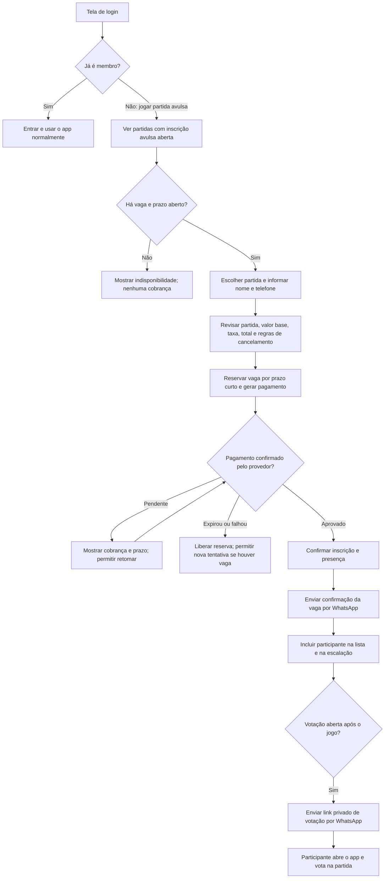

# Participação avulsa em partidas — desenho inicial

**Status:** regras decididas em 2026-10-21 (seção "Decisões"); sem
implementação. Onde o texto do desenho inicial divergir das decisões, valem
as decisões.

## Objetivo

Permitir que uma pessoa sem cadastro de mensalista compre uma vaga em uma
partida específica. Após a confirmação do pagamento, seu nome entra na lista
de presença e na escalação, e ela recebe uma confirmação pelo WhatsApp. Quando
a votação da partida abrir, recebe pelo WhatsApp um link privado para votar no
aplicativo. A inscrição não a torna mensalista nem lhe dá acesso às outras
partidas ou às áreas administrativas.

Cada inscrição avulsa destina **R$ 25,00 ao caixa do grupo**, para compras
relacionadas ao futebol. A taxa do Pix é embutida no preço, como na
mensalidade: o avulso vê só o total (R$ 25,25) e o caixa recebe R$ 25,00. O
valor arrecadado não compõe o rateio da mensalidade nem o custo da partida.

O app já tem uma *cobrança avulsa de partida* criada pelo admin para usuários
cadastrados. Esta proposta é outra modalidade: inscrição e pagamento feitos
pelo próprio participante antes da partida.

## Fluxo do participante

Na tela de login, a entrada sugerida é **“Jogar uma partida avulsa”**. O
participante vê data, horário, local, vagas e preço antes de informar seus
dados. O total cobrado é exibido antes da criação do pagamento. A tela de
pagamento mostra o estado real retornado pela API; voltar do provedor ou
fechar o navegador não confirma a vaga por si só.

Antes de pagar, o avulso vê só o **total a pagar** (R$ 25,25), sem a taxa
separada. O preço informado ao participante fica congelado na inscrição. A taxa efetiva descontada pelo
provedor e o valor líquido recebido devem ser registrados na conciliação;
se diferirem da estimativa, a cobrança já apresentada ao participante não é
alterada retroativamente.

O WhatsApp de confirmação informa partida, data, horário, local e que a
presença está confirmada. Ele só é agendado após o pagamento aprovado e a
inscrição efetivada. O link de votação só é enviado quando a partida entra no
estado `voting`, seja pela ação do admin, seja pela abertura automática após o
horário do jogo. A mensagem informa o prazo de votação.

Textos iniciais para as mensagens:

> Sua presença na partida de **[data] às [horário]**, em **[local]**, está
> confirmada. Você receberá o link para votar após o encerramento da partida.

> A votação da partida de **[data]** está aberta até **[prazo]**. Vote no
> app: **[link privado]**.

## Estados da inscrição

| Estado | Significado | Consome vaga? | Entra na presença e nos times? |
| --- | --- | --- | --- |
| `reserved` | Dados aceitos, pagamento em criação | Sim, temporariamente | Não |
| `pending_payment` | Cobrança criada, aguardando confirmação | Sim, até expirar | Não |
| `confirmed` | Pagamento aprovado e inscrição efetivada | Sim | Sim |
| `expired` | Prazo da reserva ou cobrança acabou | Não | Não |
| `cancelled` | Inscrição cancelada conforme regra definida | Não, se antes do fechamento | Não |
| `refund_pending` / `refunded` | Partida cancelada ou reembolso devido/concluído | Conforme decisão operacional | Não |

Uma inscrição pertence a uma única partida. Repetir uma requisição ou receber
o webhook mais de uma vez não cria duas inscrições, cobra duas vezes nem ocupa
duas vagas. A confirmação da vaga ocorre em uma transação que verifica o
pagamento, o prazo da partida e a capacidade. O retorno do navegador não é
prova de pagamento. Pagamento aprovado após a expiração da reserva exige uma
regra explícita: confirmar somente se ainda houver vaga ou encaminhar para
reembolso/atendimento.

## Administração e regras de acesso

- O admin habilita a modalidade por partida, define vagas avulsas, prazo de
  inscrição e preço. A oferta pública deve incluir apenas as partidas
  habilitadas e dados necessários para a escolha; não expõe telefone nem
  presença dos membros.
- Em **Admin → Usuários**, adicionar um filtro de **Tipo** com **Membros** e
  **Avulsos**. O valor inicial é **Membros**, para manter a lista operacional
  atual focada no grupo. A separação usa a modalidade de cadastro gravada no
  domínio, nunca o estado do pagamento ou a presença em uma partida.
- Na visão **Avulsos**, buscar por nome ou WhatsApp e filtrar por partida e
  estado da inscrição. Mostrar nome, telefone, partidas inscritas, situação do
  pagamento, confirmação de presença e situação dos dois WhatsApps. Ao abrir
  o detalhe, o admin vê cada inscrição com sua partida e pode reenviar
  mensagens ou tratar pendências. A mesma pessoa pode ter inscrições em várias
  partidas; cada linha deve mostrar a partida para tornar eventuais repetições
  claras. O telefone é um dado de contato e busca, não a única chave de
  identidade: pessoas que compartilham um número não devem ter históricos
  fundidos automaticamente.
- Na lista de presença e na escalação de cada partida, identificar o
  participante com um selo **Avulso**. O resumo da partida mostra a quantidade
  de avulsos confirmados e de pagamentos pendentes.
- Os filtros de **Perfil**, **Acesso** e **Financeiro** da lista de membros não
  devem atribuir a avulsos os estados próprios de mensalistas, como
  inadimplência por mensalidade. O detalhe do avulso não oferece ações de
  promover a admin, ativar/inativar como membro ou incluí-lo no rateio mensal.
- O telefone informado deve ser validado no formato de WhatsApp antes do
  pagamento. A tela de confirmação do pagamento permite acompanhar o estado
  da inscrição. O link recebido nesse número é o acesso à votação da partida.
  Deve ser privado, difícil de adivinhar, revogável e válido somente durante a
  janela de votação. Pode ser reaberto enquanto a votação estiver aberta para
  permitir os votos previstos nas regras atuais. Ao abrir o link, o app mostra
  somente a enquete e os participantes elegíveis daquela partida; a API
  associa os votos à inscrição avulsa, sem exigir conta de mensalista.
- Antes do pagamento, a pessoa não aparece na presença nem no sorteio. Depois
  da confirmação, aparece como participante confirmado. O link de votação não
  concede login de mensalista. O admin pode corrigir presença e escalação se a
  pessoa não comparecer.
- A votação mantém as regras atuais: somente participantes efetivos votam e
  recebem votos, durante a janela aberta. A decisão de usar `going` como prova
  de participação deve contemplar faltas de avulsos e de mensalistas.
- Cadastro avulso não entra no rateio das mensalidades, não recebe convites ou
  notificações de outras partidas e não ganha acesso ao restante do grupo.
- Os dois WhatsApps são enviados por fila com registro de tentativas. Falha
  no envio não desfaz um pagamento nem remove a vaga. O admin vê a falha e
  pode reenviar a mensagem ou compartilhar um novo link de votação. A abertura
  da votação não deve enviar duas mensagens se a ação for repetida.

## Integração com o que existe

Hoje, `match_confirmations`, `match_team_members` e `votes` referenciam
`users.id`. O cadastro atual exige e-mail e senha e permite apenas os papéis
`player` e `admin`. O Pix atual é criado a partir de uma cobrança ligada a um
usuário autenticado. Portanto, o acesso avulso, a identidade do participante
e a cobrança por vaga precisam ser desenhados juntos antes de alterar os
contratos HTTP. A modalidade existente de cobrança avulsa administrativa
permanece distinta da inscrição avulsa feita no login.

A tela atual **Admin → Usuários** consulta `/admin/users` e filtra por perfil,
acesso e situação financeira. O novo filtro de tipo precisa valer na API e na
paginação, inclusive na contagem total; filtrar apenas os 20 resultados da
página no navegador produziria listas e totais incorretos. As inscrições
devem permanecer identificadas por partida, mesmo quando um telefone aparece
em mais de uma compra.

## Modelo de dados recomendado e migração

**Identidade.** Manter avulsos em `users` com uma coluna explícita `kind`
(`member` ou `guest`), distinta de `role` (`player` ou `admin`) e de `status`.
Isso preserva os IDs e as chaves estrangeiras que já ligam usuário a presença,
time e voto. O avulso fica com `role = player`, `kind = guest` e sem credenciais
de login de membro. Adicionar `kind` com `not null default 'member'`: todas as
linhas existentes passam a ser membros sem alteração de ID, senha, papel,
status ou histórico. A migração permite e-mail e senha nulos apenas para
`guest`, preservando sua obrigatoriedade para `member`; não criar e-mails
fictícios nem senhas artificiais. Um `check` impede `kind = guest` com
`role = admin`. A leitura em Go e os tipos da PWA devem aceitar e-mail ausente
na representação do avulso; os contratos antigos de membros continuam
retornando e-mail como antes.

**Inscrição.** Criar `guest_bookings` com IDs de partida e avulso, estado da
inscrição, preço base, taxa, total congelado no momento da compra, prazos,
data de confirmação e motivo de cancelamento/reembolso. Impor uma inscrição
ativa por identidade avulsa e partida; a regra para identificar compras
repetidas pelo mesmo nome/telefone ainda precisa ser definida. Registrar
tentativas de pagamento e referências do provedor em estrutura própria, com
unicidade e idempotência; uma nova tentativa não sobrescreve o histórico de
outra. O webhook atual busca apenas
`charges`, então deve distinguir a referência de inscrição avulsa e concluir
a inscrição na mesma transação que grava a aprovação.

**Caixa.** Para cada pagamento aprovado, conservar em centavos o valor base
destinado ao grupo (`2500`), a taxa exibida ao comprador, o total cobrado, a
taxa efetiva do provedor e o líquido recebido quando esses dados estiverem
disponíveis. O admin pode consultar entradas por partida/período e estornos,
sem misturá-los às mensalidades. Se houver cancelamento e reembolso, o resumo
do caixa precisa refletir o estorno. Um saldo que também desconte compras do
grupo dependerá de registrar essas despesas no app.

**Votação e mensagens.** O vínculo de `match_confirmations`,
`match_team_members` e `votes` continua apontando para `users.id`. Inserir
`going` para o avulso somente ao confirmar a compra. Guardar o hash do token
do link de votação, o vínculo com a inscrição e sua validade; o token permite
apenas ler e votar na partida correspondente. Identificar mensagens de
confirmação e de votação por inscrição e tipo, para agendar uma vez e permitir
reenvio auditável. A abertura manual e a automática da votação devem usar o
mesmo agendamento.

**Isolamento dos membros.** Revisar todas as consultas que hoje usam somente
`status = 'active'`: `ActiveUsers` e rateio mensal, criação de partidas e
confirmações iniciais, push de partida, avisos gerais, dashboard, lista admin
e inativação por inadimplência. Elas passam a exigir `kind = 'member'` quando
se referem ao grupo. O login, cadastro por convite, recuperação de senha,
rotas com `requireAuth` e edição administrativa de papel/status também
precisam rejeitar a identidade avulsa como conta de membro. A listagem antiga
`/admin/users` mantém **Membros** como padrão para que a PWA anterior não
mostre avulsos antes de receber o novo filtro.

**Publicação.** Fazer migrações aditivas: primeiro coluna, tabelas e proteção
das consultas; depois API de inscrição/pagamento/voto; por fim as novas telas.
Não reescrever os usuários existentes nem as migrations antigas. Uma compra
avulsa não cria `charge_batch` mensal e não altera cobranças antigas.

## Decisões (2026-10-21)

Respostas do grupo às perguntas do desenho inicial. Itens marcados
"padrão" não foram perguntados: são o comportamento adotado, sujeito a
revisão.

**Dinheiro**
- **Meio de pagamento:** Pix pelo Mercado Pago, a mesma integração das
  mensalidades. Cartão fica para depois.
- **Preço:** `guest_price_cents` nas configurações (padrão 2500), editável
  pelo admin. O valor vigente é congelado na partida quando o admin abre a
  venda.
- **Taxa:** embutida, calculada por `billing.DefaultPixRate.PassOn` (a
  mesma da mensalidade). O avulso vê só o total; 2500 vira 2525.
- **Reembolso:** só se a partida for cancelada. As inscrições confirmadas
  vão para `refund_pending`; o admin estorna no Mercado Pago e marca
  `refunded`. Desistência não é reembolsada.
- **Caixa:** registra **entradas e despesas**, com saldo:
  - entradas: inscrições aprovadas, com valor base, total cobrado e taxa
    estimada;
  - estornos: saídas ligadas à inscrição;
  - despesas: lançadas pelo admin, com descrição, valor e data.

  O caixa não se mistura com mensalidades.

**Vagas e reserva**
- **Abertura da venda:** o admin libera a venda **por partida** e define o
  número de vagas.
- **Fim da venda:** fecha junto com o prazo de confirmação. Venda só com a
  partida `open`.
- **Reserva:** dura **30 minutos**, e o Pix expira no mesmo instante.
- **Pagamento depois da reserva expirada:** **sempre reembolsa**. A
  inscrição vai para `refund_pending` e nunca vira vaga.
- **Limite por pessoa:** **uma vaga por WhatsApp por partida.** Uma
  inscrição ativa (`reserved`, `pending_payment`, `confirmed`) por telefone
  normalizado e partida. Isso também impede prender várias vagas.
- **Mesmo telefone em outra partida:** depois de uma inscrição expirar, o
  mesmo telefone pode tentar de novo se houver vaga.

**Identidade**
- **Cada inscrição é independente:** toda compra cria um avulso novo em
  `users` (`kind = 'guest'`, `role = 'player'`, sem e-mail e sem senha).
  Não há fusão por telefone nem com membros.
- **Formulário:** nome, WhatsApp e **e-mail**. O Mercado Pago exige o
  e-mail do pagador.
  - Como `users.email` é único e um avulso repete e-mail entre compras, o
    e-mail fica **na inscrição** e não em `users`.
  - Ele serve para o Pix e para o contato.

**Partida e votação**
- **Pagou, participa:** a inscrição confirmada grava `going` e o avulso
  entra na presença, no sorteio e na votação. Vota e recebe voto mesmo se
  faltar. As categorias são as atuais (artilheiro, perna de pau, melhor
  gol), com as mesmas regras.
- **Presença (padrão):** o avulso não altera a presença depois de pagar. O
  admin pode corrigir presença e escalação como faz com membros.
- **Link de voto:** token privado, guardado só como hash, válido na janela
  de votação da partida. Permite só ler a enquete e votar nela.
- **Envio do link:** vai por WhatsApp quando a partida entra em `voting`,
  seja pelo admin ou pela abertura automática, uma vez por inscrição.
- **Suporte (padrão):** o admin reenvia a confirmação e o link pela tela
  de Avulsos.

**Página pública**
- **Antes de pagar:** mostra **tudo**: data, horário, local **com
  endereço**, vagas restantes e valor.
- **Nunca mostra** a lista de presença, telefones ou nomes de membros.
- **Abuso (padrão):** limite de requisições por IP nos endpoints públicos
  de inscrição, além da regra de uma vaga por telefone.

## Critérios para considerar o fluxo pronto para implementação

- O participante conhece o total e a partida exata antes de pagar.
- O admin consegue separar o valor destinado ao caixa, taxas, total cobrado,
  líquido recebido e estornos, por partida e por período.
- Cada pagamento aprovado resulta em no máximo uma vaga na partida correta.
- Vaga pendente é liberada ao expirar; pagamento tardio tem resolução definida.
- Apenas participantes confirmados aparecem para presença, escalação e voto.
- Um pagamento confirmado agenda uma única mensagem de confirmação para o
  WhatsApp informado, com possibilidade de reenvio controlado.
- Ao abrir a votação, cada avulso elegível recebe um link privado da sua
  partida; o link deixa de aceitar votos ao encerrar a votação.
- O link de votação não revela dados ou rotas de outras partidas do grupo.
- Admin consegue identificar inscrições pendentes, confirmadas e casos que
  exigem reembolso, reenvio de WhatsApp ou atendimento.
- Admin consegue alternar entre membros e avulsos, buscar um avulso por
  nome/telefone e abrir seu histórico por partida; totais e paginação seguem
  o filtro selecionado.
